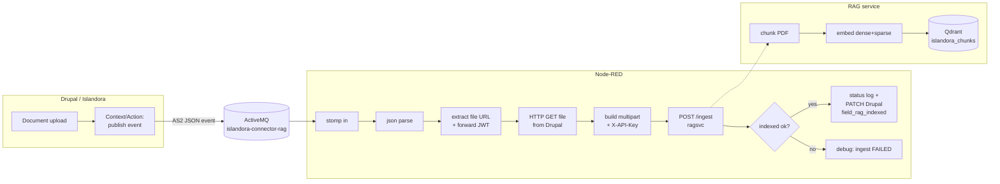
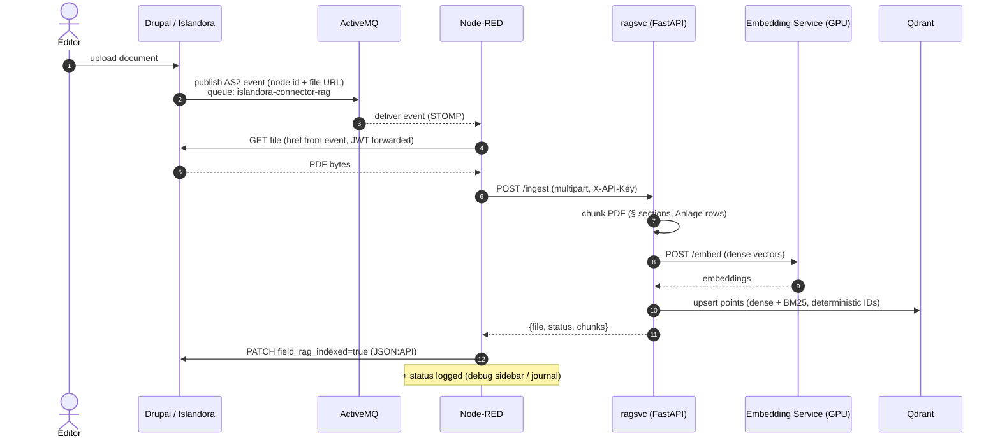

# RAG Ingest Flow (Node-RED)

Event-driven indexing: when a document lands in Islandora, this flow picks up
the ActiveMQ event, fetches the PDF, sends it to the RAG service for chunking +
embedding, and reports the result. Verified end-to-end on 2026-07-14
(synthetic event → 34 chunks upserted into Qdrant, idempotent on re-delivery).

## Flow



Re-delivering the same document overwrites its previous chunks (deterministic
IDs in the RAG service) — duplicate events are harmless.

## Who calls what (sequence)



Steps 1–2 are Drupal configuration (Context/Action). Steps 3–13 are this flow
plus the RAG service. When ragsvc runs on the GPU VM next to the embedding
service and Qdrant, steps 8–10 are localhost calls.

## Deploy the flow

**Via Makefile (recommended):**

```bash
cd rag
make flow-deploy    # imports/updates the flow via the Node-RED admin API
make flow-test      # fires a synthetic event through ActiveMQ
```

**Via the Node-RED UI:**

1. Open Node-RED: `http://localhost:1881` (host port for the isle-dc container).
2. Menu (☰, top right) → **Import** → **select a file to import** →
   choose `isle-dc/build/nodered-data/rag-ingest-flow.json` → **Import**.
3. A new tab "RAG Ingest" appears. Click **Deploy** (top right).
4. Check the ☰ → **Configuration nodes**: the `activemq` stomp-server should
   show "connected". The debug sidebar (🐞) shows per-document results.

## Configuration (environment variables on the nodered container)

| Variable | Purpose | Default |
| --- | --- | --- |
| `RAGSVC_URL` | Base URL of the RAG service | `http://host.docker.internal:8000` |
| `RAGSVC_KEY` | `X-API-Key` for `/ingest` (same as `EMBEDDING_API_KEY`) | — (injected by `make flow-deploy`) |
| `DRUPAL_URL` | Enables the Drupal write-back (`PATCH field_rag_indexed`) | unset = log only |
| `DRUPAL_AUTH` | base64 `user:pass` for the Drupal JSON:API call | — |

## Drupal side (once)

Create a Context/Action that publishes media-create/update events to the queue
`islandora-connector-rag` — the same pattern as the existing
`islandora-connector-*` actions. The event's `object.url[].href` must point at
the PDF (or its extracted-text derivative).

For the write-back, add a boolean field `field_rag_indexed` to the Islandora
object bundle and adjust the bundle/field names in the
"build status + Drupal write-back" function node if yours differ.

## Known limitations

- The `node-red-contrib-stomp` nodes **receive** fine but their **send** frames
  are rejected by ActiveMQ ("content-length … no trailing null byte"), and this
  ActiveMQ image ships without the REST messaging webapp — so completion is
  reported via log + Drupal write-back instead of a status queue. If a status
  queue is ever required, install an AMQP node (`node-red-contrib-amqp`,
  ActiveMQ port 5672) for the publish leg.
- `make flow-test` expects the test PDF served on host port 8888
  (`python3 -m http.server 8888` in a folder with `brd_arzthelfer_1985.pdf`)
  and the RAG service running (`make api`).
